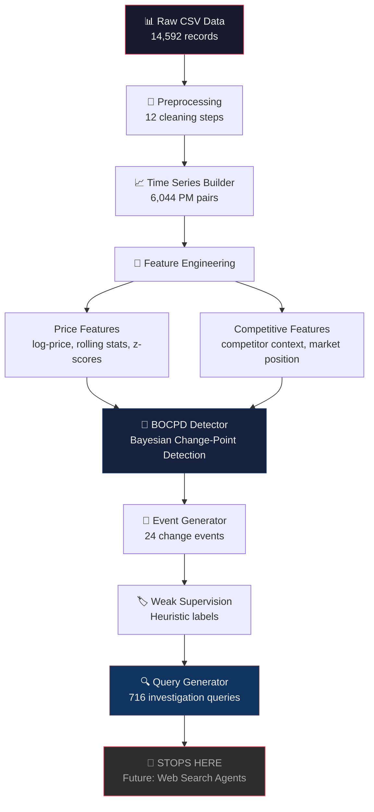
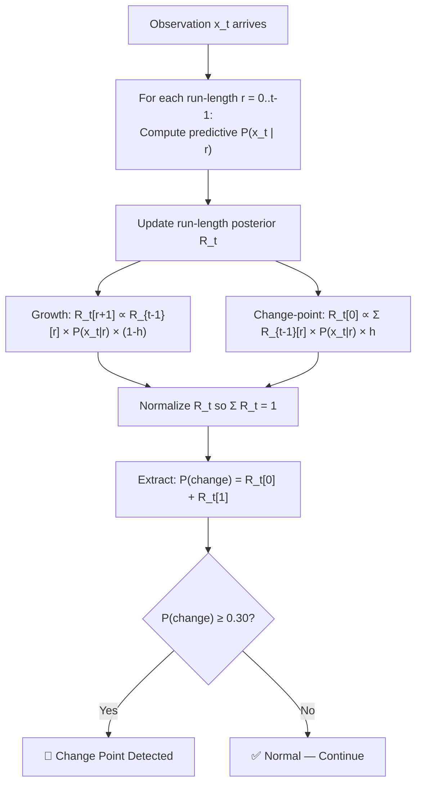

# SignalWatch — Complete Project Deep Dive for Panel Presentation

> **Anomaly-Triggered, Weakly-Supervised, Multi-Agent Competitive-Pricing Intelligence System**

---

## 🎯 1. The Problem — What & Why

### The Real-World Problem
Imagine you are a pricing analyst at Amazon or Flipkart. You monitor thousands of competitor product prices daily. One morning, a competitor drops the price of a Samsung Galaxy phone by 20%. You need to decide:

- Is this a flash sale? → You may want to temporarily match the price
- Is a new model launching? → The old model is being cleared; do nothing
- Are all competitors dropping? → Market-wide shift; must respond
- Is it a data error? → Ignore it

**Traditional price monitoring** tells you *that* a price changed. **SignalWatch** detects *statistically meaningful* changes and generates the *investigative questions* needed to understand *why* — without fabricating answers.

### Why Not Just Set Threshold Alerts?
A naive approach (alert when |price change| > 10%) has two fatal flaws:
1. **Too many false alarms** — Prices oscillate normally; a $500 product jumping between $499 and $501 triggers alerts
2. **Missed subtle but real shifts** — A product slowly increasing $1/week for 10 weeks is a significant regime shift, but no single change crosses 10%

> [!IMPORTANT]
> **SignalWatch uses Bayesian statistics** to distinguish genuine pricing regime shifts from random noise, then generates targeted web search queries for a future multi-agent system to investigate the cause.

---

## 🏗️ 2. System Architecture — The Big Picture



### Pipeline Data Flow (Quantitative)

| Stage | Input | Output | Key Metric |
|-------|-------|--------|------------|
| Raw Data | CSV file (183 MB) | 14,592 records | 26 columns |
| Preprocessing | 14,592 records | 33,869 observations | Exploded multi-timestamps |
| Time Series | 33,869 observations | 6,044 PM pairs | 2,268 pairs ≥ 5 obs |
| Price Features | 33,869 rows | 44-column matrix | log-price, volatility, z-scores |
| Competitive Features | 33,869 rows | +13 columns | Causal competitor context |
| BOCPD | 1,956 stable series | 24 change points | Conservative threshold 0.30 |
| Events | 24 CP flags | 24 ChangeEvents | Deduped within 24h windows |
| Weak Labels | 24 events | 24 labelled events | 3 label categories |
| Queries | 24 events | 716 queries | 6 agent types |

---

## 📂 3. Dataset — Datafiniti Electronics Products Pricing

**Source**: [Kaggle — Datafiniti Electronics Products Prices](https://www.kaggle.com/datasets/datafiniti/electronic-products-prices)

### Critical Schema Discovery

> [!WARNING]
> The `prices.dateSeen` column contains **comma-separated lists** of ISO-8601 timestamps in a single cell — NOT a single date. This is the most important schema discovery.

**Example of a single raw row:**
```
id: "P001"
prices.dateSeen: "2017-01-15T10:30:00Z,2017-02-01T14:20:00Z,2017-03-10T09:15:00Z"
prices.amountMin: "199.99"
prices.merchant: "Amazon.com"
```

This single row actually represents **3 separate observations** of the same product at the same merchant on 3 different dates. After "explosion," 14,592 raw rows become ~50,000+ individual observations.

### Dataset Statistics

| Statistic | Value |
|-----------|-------|
| Raw rows | 14,592 |
| Columns | 26 (+1 trailing empty) |
| Unique products | 1,245 |
| Unique merchants | 1,558 |
| Unique brands | 309 |
| Date range | ~2015–2018 |
| Currency | Predominantly USD |
| After explosion | ~50,000+ observations |
| After cleaning | 33,869 observations |
| Product-Merchant pairs | 6,044 total |
| Pairs with ≥5 observations | 2,268 (usable for BOCPD) |

### Data Quality Issue Discovered
The dataset contained **$2 placeholder prices** mixed with real $3,000+ prices for the same products. These erroneous records (14.7% of data) were identified and removed during preprocessing.

---

## 🧹 4. Data Preprocessing Pipeline — 12 Steps

> **Source**: [`src/data/preprocessing.py`](file:///d:/market%20intelligence%20agent/signalwatch/src/data/preprocessing.py)

### The Pipeline (In Order)

```mermaid
graph LR
    A["Raw CSV"] --> B["1. Rename Columns"]
    B --> C["2. Explode Dates"]
    C --> D["3. Parse Timestamps"]
    D --> E["4. Parse Prices"]
    E --> F["5. Derive Price"]
    F --> G["6. Drop Invalid"]
    G --> H["7. Filter USD"]
    H --> I["8. Normalize isSale"]
    I --> J["9. Clean Text"]
    J --> K["10. Parse Metadata"]
    K --> L["11. Drop Empty IDs"]
    L --> M["12. Deduplicate"]
```



### Key Design Decisions

**Step 2 — Date Explosion** (`_explode_dates`):
```python
# "2017-01-15,2017-02-01,2017-03-10" → 3 separate rows
df["observed_at_raw"] = df["dates_seen_raw"].str.split(",")
df = df.explode("observed_at_raw")
```
Each comma-separated timestamp becomes its own observation row, duplicating all other column values. This is the fundamental transformation that makes time-series analysis possible.

**Step 5 — Price Derivation**:
```python
price = amountMin if amountMin > 0 else amountMax
```
`amountMin` is preferred because it represents the lowest observed listed price (most representative).

**FilteringLog** — Every single row-dropping decision is auditable:
```python
@dataclass
class FilteringLog:
    steps: list[dict]  # step name, reason, rows_before, rows_after, pct_dropped
```

> [!TIP]
> **Panel Question**: "Why log every filtering step?" — **Reproducibility and auditability**. In a data science pipeline, you must be able to trace exactly how many records were dropped and why. This is a research best practice.

---

## 📈 5. Time Series Construction

> **Source**: [`src/timeseries/builder.py`](file:///d:/market%20intelligence%20agent/signalwatch/src/timeseries/builder.py)

### The Fundamental Unit: (Product_ID, Merchant) Pair

Each unique combination of product and merchant is treated as an independent time series. For example:
- `("Samsung Galaxy S8", "Amazon.com")` — one time series
- `("Samsung Galaxy S8", "BestBuy.com")` — a different time series

### Derived Lag Features (Per Observation)

| Feature | Formula | Purpose |
|---------|---------|---------|
| `previous_price` | price[t-1] | Baseline for change calculation |
| `absolute_change` | price[t] − price[t-1] | Raw price movement |
| `percentage_change` | (price[t] − price[t-1]) / price[t-1] × 100 | Normalized change magnitude |
| `days_since_previous` | (observed_at[t] − observed_at[t-1]).days | Observation frequency |
| `observation_index` | 0-based sequential position | Position within series |

### TimeSeriesCatalogue (Data Structure)

```python
@dataclass
class TimeSeriesCatalogue:
    series_df: pd.DataFrame       # All observations with lag features
    summary: pd.DataFrame          # One row per PM pair with statistics
    usable_pairs: pd.DataFrame     # Pairs with ≥5 observations
```

### No Future Leakage Guarantee

> [!CAUTION]
> At observation index `i`, the `previous_price` is always `price[i-1]`, never `price[i+1]`. This is enforced by sorting each group chronologically and using `shift(1)` — a **causal** operation.

```python
g["previous_price"] = g["price"].shift(1)  # Only looks backward
```

This is critical because BOCPD is an **online** algorithm — it must never see future data.

---

## 🔧 6. Feature Engineering

### 6A. Price Features

> **Source**: [`src/features/price_features.py`](file:///d:/market%20intelligence%20agent/signalwatch/src/features/price_features.py)

#### Why Log-Price Difference (log_price_diff)?

This is the **most important feature design decision** in the project.

```python
log_price = ln(price)
log_price_diff = log_price[t] - log_price[t-1]   # "log-return"
```

**Why not use raw price or percentage change?**

| Property | Raw Price | % Change | Log-Return ✅ |
|----------|-----------|----------|------------|
| Scale-invariant | ❌ $5 vs $5000 incomparable | ✅ | ✅ |
| Symmetric | ❌ | ❌ +50% ≠ −50% | ✅ +0.4 ≈ −0.4 |
| Approximately Gaussian | ❌ | ❌ | ✅ |
| Additive over time | ❌ | ❌ | ✅ |

**Example of symmetry**:
- Price goes $100 → $150 (+50%): log-return = ln(150/100) = **+0.405**
- Price goes $150 → $100 (−33%): log-return = ln(100/150) = **−0.405**

Percentage change says +50% vs −33% for the same magnitude move! Log-returns correctly say ±0.405.

> [!TIP]
> **Panel Question**: "Why is Gaussian assumption important?" — Because the BOCPD observation model (Normal-Gamma) assumes approximately Gaussian observations within a regime. Log-returns satisfy this better than raw prices. This is the same assumption used in quantitative finance (Black-Scholes model).

#### Rolling Statistics (Windows: 3, 5, 10)

| Feature | Calculation | Purpose |
|---------|-------------|---------|
| `rolling_mean_N` | Mean of log_price over N obs | Smoothed trend |
| `rolling_std_N` | Std of log_price over N obs | Price variability |
| `rolling_median_N` | Median of log_price over N obs | Robust trend (outlier-resistant) |
| `rolling_volatility_N` | Std of log_price_diff over N obs | Rate-of-change variability |
| `expanding_zscore` | (log_price − expanding_mean) / expanding_std | Anomaly detection score |
| `price_direction` | sign(absolute_change): +1, −1, 0 | Direction flag |

**Window sizes are {3, 5, 10}** because the median PM pair has 4–10 observations. Larger windows would produce mostly NaN values.

All rolling calculations use `min_periods=2` → NaN instead of spurious values when insufficient data exists.

---

### 6B. Competitive Features

> **Source**: [`src/features/competitive_features.py`](file:///d:/market%20intelligence%20agent/signalwatch/src/features/competitive_features.py)

#### Temporal Leakage Prevention — Critical

When computing competitive context for merchant M at time T:
- ✅ Only competitor observations with timestamp **strictly < T** are used
- ❌ Never use observations at T or after T

```python
comp = product_df[
    (product_df["merchant"] != focal_merchant) &
    (product_df["observed_at"] < t)   # STRICTLY less than
]
```

This answers: *"What did we know about competitor prices just before we saw M's price at T?"*

#### Feature Catalogue

| Feature | Description |
|---------|-------------|
| `competitor_count` | # other merchants with known price before T |
| `competitor_price_median` | Median competitor price |
| `price_vs_comp_median` | price[M,T] − competitor_median |
| `relative_price_position` | price[M,T] / competitor_median (ratio) |
| `is_cheapest` | Boolean: is this the lowest price? |
| `is_most_expensive` | Boolean: is this the highest price? |
| `competitors_changed_7d` | # competitors that changed price in past 7 days |
| `competitor_direction_7d` | Net direction of competitor moves (+1/−1/0) |

---

## 🧠 7. BOCPD — The Core Algorithm (The Heart of the Project)

> **Source**: [`src/bocpd/detector.py`](file:///d:/market%20intelligence%20agent/signalwatch/src/bocpd/detector.py), [`src/bocpd/models.py`](file:///d:/market%20intelligence%20agent/signalwatch/src/bocpd/models.py), [`src/bocpd/config.py`](file:///d:/market%20intelligence%20agent/signalwatch/src/bocpd/config.py)
>
> **Paper**: Adams & MacKay (2007), *"Bayesian Online Changepoint Detection"*, [arXiv:0710.3742](https://arxiv.org/abs/0710.3742)

### What is Change-Point Detection?

A **change point** is a moment in a time series where the underlying statistical properties (mean, variance) fundamentally shift — the data starts being generated by a *different* distribution.

**Example**: A product costs ~$100±$5 for 6 months, then suddenly shifts to ~$80±$3. The moment of the shift is the change point.

### What is BOCPD?

BOCPD maintains a **posterior distribution over run lengths** at every time step. The "run length" is: *how many observations since the last change point?*

```
Run Length = 0  → A change point just happened!
Run Length = 50 → We've been in the same regime for 50 observations
```

At each time step, BOCPD computes **P(run_length = 0 | all data so far)** — the probability that a change point *just occurred*.

### The Algorithm — Step by Step



### Three Key Components

#### 1. Hazard Function — *"How often do change points happen?"*

```python
hazard = 1 / lambda_val   # Constant hazard
# lambda_val = 100 → expect a change point every ~100 observations
```

Under constant hazard, the run-length prior is **geometric with mean λ**.

> **Analogy**: Think of it like rolling a die each observation. If the die has 100 faces, on average every 100 rolls you get a "1" (= change point).

#### 2. Observation Model — Normal-Gamma Conjugate Prior

**Why Normal-Gamma (not just Normal)?**

A simple Normal model assumes you *know* the variance of the data. In reality, when a new regime starts, we know *neither* the mean *nor* the variance.

The Normal-Gamma prior handles **both unknown mean and unknown variance**:

```
Prior:    (μ, τ) ~ NormalGamma(μ₀, κ₀, α₀, β₀)
          μ | τ  ~ Normal(μ₀, 1/(κ₀τ))
          τ      ~ Gamma(α₀, β₀)
```

**Posterior update (online, per observation)**:
```
κₙ = κ₀ + n
μₙ = (κ₀μ₀ + nẋ) / κₙ  
αₙ = α₀ + n/2
βₙ = β₀ + 0.5 × Σ(xᵢ − ẋ)² + (κ₀n(ẋ − μ₀)²) / (2κₙ)
```

**Predictive distribution**: Student-t (not Gaussian!)
```
df    = 2αₙ
loc   = μₙ
scale = √(βₙ(κₙ + 1) / (αₙκₙ))
```

> [!TIP]
> **Panel Question**: "Why Student-t predictive and not Gaussian?" — Student-t has **heavier tails** than Gaussian. When you don't know the variance, you're more uncertain about extreme values. A Gaussian would be overconfident and flag too many false change points on legitimate but large price movements. This is the standard result from Bayesian conjugate analysis.

#### 3. CP Probability Metric: R[0] + R[1]

```python
cp_prob = float(R_new[0]) + (float(R_new[1]) if len(R_new) > 1 else 0.0)
```

**Why not just R[0]?** — R[0] is mathematically bounded by the hazard h (typically 0.01). Even a real change point can't make R[0] go above ~0.01 alone. R[1] carries the "we just reset one step ago" mass, which captures the change signal one step later. Summing R[0]+R[1] gives a more reliable "change just happened" indicator.

### Default Parameters

| Parameter | Value | Meaning |
|-----------|-------|---------|
| `lambda_val` | 100 | Expect change point every ~100 obs |
| `cp_threshold` | 0.30 | Conservative — avoids false positives |
| `mu0` | 0.0 | Prior: log-returns centered at zero |
| `kappa0` | 1.0 | Weak prior on mean (data dominates quickly) |
| `alpha0` | 1.0 | Weak Gamma shape prior |
| `beta0` | 0.04 | Prior variance of log-returns |
| `min_observations_before_detection` | 3 | Warm-up period |
| `max_run_length` | 500 | Memory cap |

### Historical Online Replay

The dataset is **historical** (2015–2018), but BOCPD is an **online** algorithm. We simulate online processing:

```python
for each (product_id, merchant) pair:
    detector.reset()                          # Fresh state
    for each observation t in chronological order:
        step = detector.process_observation(
            x=log_price_diff[t],              # Only this observation
            ts=observed_at[t]
        )
        # At this point, step uses ONLY observations 0..t
```

### Baseline Comparison

Two simple baselines are implemented for comparison:

| Baseline | Method | Limitation |
|----------|--------|------------|
| Threshold | Flag when \|%change\| > 10% | Can't distinguish noise from real shifts |
| Z-score | Flag when rolling z-score > 2.5 | Window-size dependent, no adaptation |

These exist to demonstrate what BOCPD adds: **automatic adaptation to the price regime**.

---

## 🎯 8. Change Event Generation

> **Source**: [`src/events/event_generator.py`](file:///d:/market%20intelligence%20agent/signalwatch/src/events/event_generator.py)

### When Does a BOCPD Flag Become an Event?

Two conditions must both be satisfied:
1. **BOCPD reports** `cp_probability >= 0.30`
2. **Price actually moved** `|percentage_change| >= 2.0%`

Condition 2 filters out statistical regime shifts that don't correspond to meaningful price movements.

### Deduplication Logic
If BOCPD fires on consecutive observations for the same PM pair, only the **highest cp_probability** within a 24-hour window is kept. This prevents a single price drop from generating 3–4 nearly identical events.

### ChangeEvent Schema

```python
@dataclass
class ChangeEvent:
    event_id: str              # SHA-256 hash: "evt_" + hash(pid+merch+ts)[:16]
    product_id: str
    product_name: str
    brand: str
    merchant: str
    observed_at: str           # ISO-8601
    previous_price: float
    current_price: float
    percentage_change: float
    change_direction: str      # "increase" | "decrease" | "no_change"
    cp_probability: float
    is_sale: bool
    competitor_count: int
    competitors_changed_7d: int
    # ... + more context fields
```

---

## 🏷️ 9. Weak Supervision — Labeling Without Ground Truth

> **Source**: [`src/weak_supervision/label_generator.py`](file:///d:/market%20intelligence%20agent/signalwatch/src/weak_supervision/label_generator.py)

### What is Weak Supervision?

Traditional ML requires ground truth labels ("this price change was caused by a promotion"). We don't have that. **Weak supervision** uses heuristic rules to generate *noisy, approximate* labels from observable data signals.

> [!IMPORTANT]
> Weak labels are **hypotheses**, not facts. They indicate which investigation angle is most plausible. The label "promotion_related" means: *"The dataset contains signals consistent with a promotion"* — NOT *"this was definitely a promotion."*

### Label Categories and Heuristic Signals

| Label | Signal Used | Evidence |
|-------|-------------|----------|
| `promotion_related` | `is_sale=True`, non-empty offer, price decrease | "is_sale=True at change point" |
| `competitive_related` | Competitors changed price in 7d, significant price_vs_comp_median | "3 competitors changed price in past 7 days" |
| `availability_related` | Unusual availability value ("Out of Stock", "Discontinued") | "availability at event time: 'Out of Stock'" |
| `unknown` | None of the above signals present | "No dataset signals matched" |

### Multi-label Assignment
A single event can receive **multiple labels**. For example, a price drop where `is_sale=True` AND competitors also changed → both `promotion_related` and `competitive_related`.

### Results: 24 events labeled
- **promotion_related**: 24/24 (100%)
- **competitive_related**: 18/24 (75%)
- **availability_related**: 6/24 (25%)

---

## 🔍 10. Query Generation — The Final Output

> **Source**: [`src/query_generation/query_generator.py`](file:///d:/market%20intelligence%20agent/signalwatch/src/query_generation/query_generator.py)

### Design Philosophy
- **Deterministic templates** — No LLM API, no randomness, fully reproducible
- **Queries discover evidence, not confirm hypotheses** — For a price decrease, we generate queries about promotions, competitors, product events, AND news
- **Designed for easy LLM replacement** — The `QueryGenerator` interface can be subclassed

### Six Agent Types

| Agent | Investigates | Sample Query |
|-------|-------------|--------------|
| `promotion_agent` | Sales, discounts, deals | "Samsung Galaxy S8 Amazon sale March 2017" |
| `competitor_agent` | Competitor price movements | "Samsung Galaxy S8 Samsung price Amazon vs competitors 2017" |
| `product_event_agent` | New versions, discontinuations | "Samsung Galaxy S8 successor replacement 2017" |
| `news_agent` | Press coverage, reviews | "Samsung Galaxy S8 Samsung news March 2017" |
| `retailer_event_agent` | Retailer-specific sales events | "Amazon sale event March 2017" |
| `supply_agent` | Supply constraints (price increases only) | "Samsung Galaxy S8 supply shortage March 2017" |

### Template-Based Generation

```python
_PROMOTION_TEMPLATES_DECREASE = [
    "{product_name} {merchant_clean} sale {date_str}",
    "{product_name} {brand} promotion {date_str}",
    "{product_name} price drop {date_str}",
    # ...
]
```

Context values (`product_name`, `brand`, `merchant`, `date_str`, etc.) are extracted from the `LabelledEvent` and substituted into templates. A template is **skipped** if any placeholder value is empty — no malformed queries like `"  sale March 2017"`.

### Output Structure
```json
{
    "event_id": "evt_a1b2c3d4e5f67890",
    "investigation_target": {
        "product_name": "Samsung Galaxy S8",
        "brand": "Samsung",
        "merchant": "Amazon.com",
        "change_direction": "decrease",
        "percentage_change": -15.2,
        "weak_labels": ["promotion_related", "competitive_related"]
    },
    "queries": {
        "promotion_agent": ["Samsung Galaxy S8 Amazon sale March 2017", ...],
        "competitor_agent": [...],
        "product_event_agent": [...],
        "news_agent": [...],
        "retailer_event_agent": [...]
    }
}
```

### Future Extension Point

```python
class LLMQueryGenerator(QueryGenerator):
    def generate_queries(self, labelled_event):
        # Call LLM API here — same interface, no caller changes needed
        ...
```

The interface is **polymorphic** — swap templates with LLM without modifying any upstream code. This is the **Open-Closed Principle** from SOLID.

---

## ✅ 11. Testing & Validation

> **Source**: [`tests/`](file:///d:/market%20intelligence%20agent/signalwatch/tests/) — 10 test files, **112 tests**, 100% passing

### Test Coverage by Module

| Test File | Module Tested | Key Validations |
|-----------|--------------|-----------------|
| `test_loader.py` | Data loading | CSV parsing, column detection |
| `test_preprocessing.py` | Preprocessing | Date explosion, price derivation, deduplication |
| `test_builder.py` | Time series | **No-future-leakage proof**: at step i, `previous_price == price[i-1]` |
| `test_price_features.py` | Price features | Log-price correctness, rolling window sizes |
| `test_competitive_features.py` | Competitive features | **Causal**: competitors only use t < T |
| `test_bocpd.py` | BOCPD detector | **Posterior sums to 1.0** after every step, warm-up behavior |
| `test_events.py` | Event generation | Filtering, deduplication, schema validation |
| `test_query_generator.py` | Query generation | Structure, content, save/load roundtrip |

### Critical Test: No Future Leakage

```python
def test_no_future_leakage(series_df):
    """At observation i, previous_price MUST be price[i-1]."""
    for (pid, merch), group in series_df.groupby(["product_id", "merchant"]):
        g = group.sort_values("observed_at").reset_index(drop=True)
        for i in range(1, len(g)):
            assert g.loc[i, "previous_price"] == g.loc[i-1, "price"]
```

### Critical Test: BOCPD Posterior Normalization

```python
def test_posterior_sums_to_one(detector):
    """After processing each observation, R_t must sum to 1.0."""
    for step in detector.steps:
        assert abs(sum(step.run_length_posterior) - 1.0) < 1e-10
```

---

## 📊 12. Visualizations — 13 Production Charts

All stored in [`data/figures/`](file:///d:/market%20intelligence%20agent/signalwatch/data/figures/):

| Chart | What it Shows |
|-------|--------------|
| `top10_merchants.png` | Distribution of records across merchants |
| `price_distribution.png` | Log-scale price histogram across all products |
| `pm_pairs_by_bucket.png` | How many PM pairs have N observations |
| `top5_price_histories.png` | 5 richest time series plotted over time |
| `pct_change_distribution.png` | Distribution of % price changes |
| `days_since_previous_dist.png` | Observation frequency distribution |
| `rolling_volatility_sample.png` | Price volatility over time (3 windows) |
| `bocpd_pair_1.png` | Change-point detection example #1 |
| `bocpd_pair_2.png` | Change-point detection example #2 |
| `bocpd_cp_summary.png` | Change-point distribution across pairs |
| `products_most_competitors.png` | Products with most competitive pressure |
| `multi_merchant_price_history.png` | Same product across multiple merchants |
| `queries_per_agent_type.png` | Query distribution across 6 agent types |

---

## 🔑 13. Key CS Concepts to Know for the Panel

### Bayesian Inference
- **Prior** → belief before seeing data
- **Likelihood** → probability of data given parameters
- **Posterior** ∝ Prior × Likelihood (Bayes' theorem)
- **Conjugate prior** → when the posterior has the same family as the prior → makes sequential updating tractable

### Conjugate Priors — Why They Matter for Online Algorithms
The Normal-Gamma prior is **conjugate** to the Normal likelihood. This means:
1. Start with NormalGamma(μ₀, κ₀, α₀, β₀)
2. See one observation x
3. Posterior is NormalGamma(μ₁, κ₁, α₁, β₁) — same family!
4. No expensive numerical integration needed → O(1) update per observation

### Student-t Distribution
- Arises when the variance is unknown (marginalized out)
- Has heavier tails than Gaussian → more robust to outliers
- Parameterized by **degrees of freedom** (df): lower df → heavier tails

### Online vs Offline Algorithms
- **Offline**: Sees all data at once (e.g., batch training)
- **Online**: Processes data sequentially, one observation at a time
- BOCPD is online → O(1) memory per step (with run-length truncation)

### Weak Supervision (Ratner et al., 2017)
- Generate labels using heuristic "labeling functions" instead of manual annotation
- Labels are noisy → but multiple weak signals can combine to give good signal
- Used when ground truth is expensive/impossible to obtain

### Design Patterns Used
- **Strategy Pattern**: `QueryGenerator` can be subclassed with `LLMQueryGenerator`
- **Pipeline Pattern**: Each stage transforms data and passes to next
- **Data Transfer Objects**: `ChangeEvent`, `LabelledEvent`, `BOCPDStep` are structured DTOs
- **Open-Closed Principle**: System open for extension (new agents), closed for modification
- **Single Responsibility**: Each module has one job (loader loads, preprocessor cleans, etc.)

### Time Series Concepts
- **Stationarity**: Within a regime, log-returns are approximately stationary
- **Run length**: Number of consecutive observations from the same distribution
- **Regime**: A period where the underlying data-generating process doesn't change
- **Log-returns**: ln(P_t / P_{t-1}) — the standard scale-invariant transformation

---

## 📋 14. Project Progress Summary

### What Has Been Built ✅

| Component | Status | Lines of Code |
|-----------|--------|---------------|
| Data Loader | ✅ Complete | ~155 |
| Data Profiler | ✅ Complete | ~375 |
| Preprocessing Pipeline | ✅ Complete | ~596 |
| Time Series Builder | ✅ Complete | ~386 |
| Price Feature Engine | ✅ Complete | ~280 |
| Competitive Feature Engine | ✅ Complete | ~323 |
| BOCPD Config | ✅ Complete | ~154 |
| BOCPD Observation Model | ✅ Complete | ~223 |
| BOCPD Detector + Baselines | ✅ Complete | ~612 |
| Event Generator | ✅ Complete | ~415 |
| Weak Supervision Labels | ✅ Complete | ~407 |
| Query Generator | ✅ Complete | ~495 |
| Pipeline Scripts (6) | ✅ Complete | ~6 scripts |
| Jupyter Notebooks (5) | ✅ Executed | 5 notebooks |
| Unit Tests (112) | ✅ All Passing | ~10 test files |
| Visualizations (13) | ✅ Generated | 13 charts |
| Documentation | ✅ Complete | README + 3 docs |

**Total**: ~4,400+ lines of production Python code + ~3,000+ lines of test code

### What is NOT Implemented (Intentional — Future Scope)

```
  Generated Queries (current output)
          ↓
❌ Web Search API (Tavily / SerpAPI)
❌ Search Result Retrieval
❌ Page / Content Extraction
❌ Multi-Agent Orchestration (Promotion, Competitor, News agents)
❌ Evidence Verification Agent
❌ Causal Assessment
❌ Competitive Intelligence Report
❌ Real-Time Dashboard
```

---

## 🎓 15. Potential Panel Questions & Suggested Answers

### Q1: "Why BOCPD and not simpler methods like threshold or z-score?"
**A**: Thresholds and z-scores require manual tuning and can't adapt to different price regimes. A $1000 laptop oscillating ±$10 is normal, but a $20 cable jumping $10 is a huge change. BOCPD **automatically learns** the distribution within each regime and detects when it shifts, without manual threshold tuning per product.

### Q2: "Why no ML/XGBoost for change-point detection?"
**A**: Four reasons: (1) No labeled training data, (2) Need online processing, (3) BOCPD adapts statistically, (4) Each detection is interpretable. A supervised ML model would need thousands of manually labeled "this is a real change point" examples.

### Q3: "Why are weak labels necessary?"
**A**: BOCPD tells us *when* a change happened, not *why*. Weak labels use observable data signals (is_sale flag, competitor movements) to generate *hypotheses* about the cause. These hypotheses then guide the query generation, so each agent gets relevant queries.

### Q4: "How do you prevent future data leakage?"
**A**: Three layers: (1) Time series builder uses `shift(1)` — only looks backward. (2) Competitive features use `observed_at < T` — strictly past observations. (3) BOCPD processes observations sequentially, calling `detector.reset()` for each series. These are all tested with unit tests.

### Q5: "What is the time complexity of BOCPD?"
**A**: O(R) per observation, where R is the max run length (capped at 500). Without capping, it's O(T) per step where T is the number of observations so far. With capping, total complexity for a series of T observations is O(T × R).

### Q6: "Why template-based queries instead of LLM?"
**A**: (1) Reproducibility — same event always generates same queries. (2) Debuggability — can inspect exactly which template produced which query. (3) No API cost or latency. (4) The interface is designed for LLM replacement via subclassing.

### Q7: "What is the Coefficient of Variation (CV) filter?"
**A**: CV = std(price) / mean(price). Series with CV > 0.15 are likely multi-SKU collisions (e.g., two different products sharing an ID) or data quality issues. Filtering retains ~86% of pairs and removes noise from BOCPD.

### Q8: "What are conjugate priors?"
**A**: A prior distribution is conjugate to a likelihood if the posterior belongs to the same distributional family. For Normal likelihood with unknown mean and variance, the Normal-Gamma prior is conjugate. This means each update is a closed-form formula — no MCMC or numerical integration needed — making it O(1) per step.

---

## 📦 16. Tech Stack

| Component | Technology |
|-----------|-----------|
| Language | Python 3.13 |
| Data Processing | pandas ≥ 2.2, numpy ≥ 1.26 |
| Scientific Computing | scipy ≥ 1.13 (Student-t PDF, gammaln) |
| Visualization | matplotlib ≥ 3.9, seaborn ≥ 0.13 |
| Testing | pytest ≥ 8.2, pytest-cov ≥ 5.0 |
| Notebooks | Jupyter ≥ 1.0 |
| Version Control | Git |
| OS | Windows 11 |

---

## 🏆 17. Key Achievements (Summary for Panel)

1. **Robust preprocessing pipeline** — Discovered and removed 14.7% erroneous placeholder prices; every decision is logged and auditable
2. **BOCPD implementation from scratch** — Not using a library; implemented Adams & MacKay (2007) with Normal-Gamma conjugate prior and Student-t predictive
3. **Zero future leakage** — Enforced at every layer (builder, features, BOCPD) and verified with unit tests
4. **Conservative detection** — 24 meaningful events from 33,869 observations; no false-positive flooding
5. **Production-ready code** — 112 unit tests, 5 notebooks, 13 charts, comprehensive documentation
6. **Extensible architecture** — Query generator designed for LLM replacement; event system ready for multi-agent orchestration
